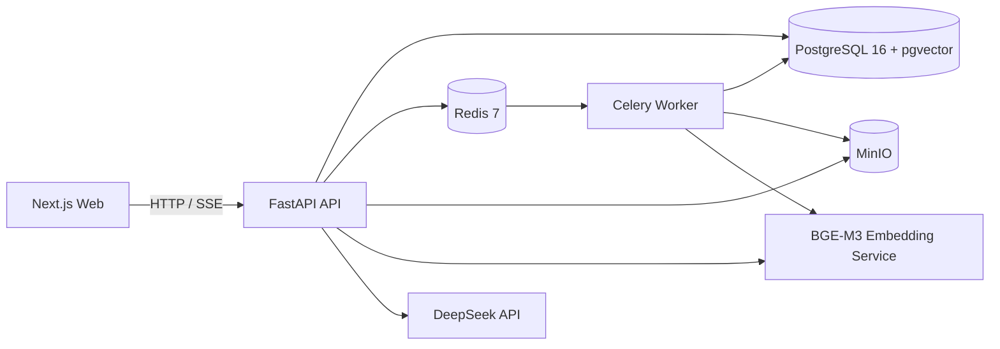
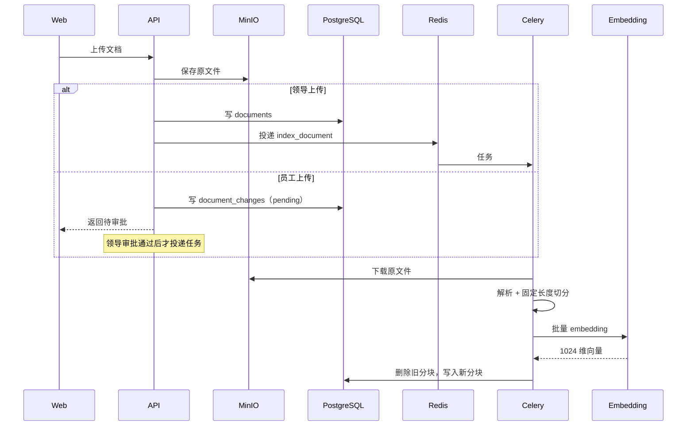
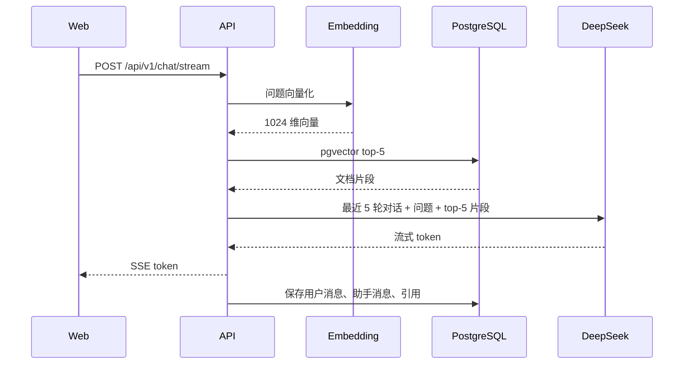

# 02 总体架构设计

## 1. 设计目标与原则

1. **模块化单体优先**：首版不拆微服务，业务放在一个 FastAPI 应用内，按领域分模块；避免过早引入分布式复杂度。
2. **异步处理重任务**：文档解析、切分、embedding 走 Celery，上传接口快速返回。
3. **契约先行**：API、数据库、工单状态机、错误码先定义，再写代码。
4. **数据不出本机**：文档原文、向量、附件都保存在本机；只有"用户问题 + top-5 检索片段 + 最近 5 轮对话"发送到 DeepSeek。
5. **可替换**：LLM、embedding、对象存储都通过配置和接口隔离；未来换本地模型或云 OSS 时，业务代码不变。
6. **工程化底线**：环境配置、数据库迁移、健康检查、结构化日志、统一错误码、OpenAPI 文档。

## 2. 逻辑架构



## 3. 组件职责

| 组件 | 职责 |
|---|---|
| `web` | 登录、问答、文档、文档审批、工单、历史页面；SSE 流式渲染；角色化导航 |
| `api` | 认证与 RBAC、REST 接口、SSE 编排、文档变更审批、工单状态机、调用 embedding 与 DeepSeek |
| `worker` | 异步执行文档解析、切分、embedding、向量写入、旧分块替换 |
| `embedding` | 加载 BGE-M3，提供批量文本向量化 HTTP 接口；GPU 优先，CPU 兜底 |
| `postgres` | 业务数据、工单事件、会话消息、文档分块与向量 |
| `redis` | Celery broker / result backend；后续可扩展缓存 |
| `minio` | 文档原文件与工单附件对象存储 |
| `DeepSeek` | 生成回答的外部 LLM API |

## 4. 技术选型与理由

| 层次 | 选型 | 理由 |
|---|---|---|
| 后端 | FastAPI | 异步、类型友好、OpenAPI 自动生成、SSE 支持好 |
| ORM | SQLAlchemy 2.0 async | 成熟、异步、与 Alembic 配套 |
| 迁移 | Alembic | 版本化数据库变更，支持 pgvector 扩展 |
| 数据库 | PostgreSQL 16 + pgvector | 业务数据与向量同库，事务一致，运维简单 |
| 队列 | Redis 7 + Celery 5 | 文档解析慢任务异步化，重试机制成熟 |
| 对象存储 | MinIO | 兼容 S3，本机可跑，未来可替换云 OSS |
| Embedding | BGE-M3（本地） | 中文效果好，1024 维稠密向量，支持长文本 |
| 生成 | DeepSeek API | 成本低、中文效果好、OpenAI 兼容接口 |
| 前端 | Next.js 15 App Router + TypeScript + Tailwind + shadcn/ui | 工程化、组件化、开发效率高 |
| 认证 | JWT + httpOnly Cookie | 避免令牌落在 localStorage；配合 SameSite 降低 CSRF 风险 |

运行环境：业务后端容器使用 Python 3.12；embedding 容器使用 Python 3.11，避免 3.13 的 ML 依赖轮子不齐。前端在宿主机使用 Node 26 运行；如遇兼容问题，切换到 Node 22 LTS 容器。

## 5. 关键流程

### 5.1 登录

1. 前端提交用户名、密码到 `POST /api/v1/auth/login`。
2. 后端校验密码，签发 JWT，写入 httpOnly Cookie。
3. 前端调用 `GET /api/v1/auth/me` 获取当前用户与角色。
4. 后续请求自动携带 Cookie；后端从 Cookie 读取令牌并校验角色。

### 5.2 文档入库



解析与任务说明：

- PDF：pypdf 提取文本；DOCX：python-docx 提取段落；Markdown/TXT：按纯文本读取。
- 统一空白字符后按字符数固定切分，默认 800 字、100 字重叠。
- 无文本的 PDF（扫描件）首版视为空文档，索引失败或产生 0 个分块。
- Celery 任务 `index_document(document_id, old_object_key?)`，最多重试 3 次，指数退避。
- 任务开始时置 `indexing`，成功置 `ready`，失败置 `failed`；成功后删除旧对象。

### 5.3 RAG 问答



首版检索始终取 top-5（知识库有分块时），不设相似度阈值；是否拒答由提示词约束模型判断。知识库为空或没有任何分块时，直接返回固定拒答话术，不调用模型。

- 引用列表固定为本次检索到的 top-5 片段，不要求模型输出引用编号。
- 多轮上下文取最近 5 组 user/assistant 消息；首版检索只使用当前问题，不做 query rewrite。
- 未配置 `DEEPSEEK_API_KEY` 且 `LLM_PROVIDER=auto` 时，后端使用本地模拟回答，仅用于联调；配置 Key 后自动切换 DeepSeek。

### 5.4 工单流转

工单状态机、权限和并发控制详见 [05-工单状态机与权限矩阵](05-工单状态机与权限矩阵.md)。核心原则：

- 员工提交的工单由领导最终审核。
- 领导提交的工单由提交领导在"待用户确认"环节确认。
- 任何"修改完成"都要领导审核后才能回到处理中。

### 5.5 Embedding 服务内部接口

`POST /embed`

```json
{
  "texts": ["第一段", "第二段"],
  "batch_size": 16
}
```

响应：

```json
{
  "embeddings": [[0.01, -0.02, "..."], [0.03, 0.04, "..."]],
  "dimension": 1024,
  "model": "BAAI/bge-m3"
}
```

`GET /health` 返回 `{"status":"ok","device":"cuda","model_loaded":true}`。GPU 不可用时 `device` 为 `cpu`。

## 6. 部署架构

### 6.1 本机 Docker Compose

| 服务 | 端口 | 说明 |
|---|---|---|
| `web` | 3000 | Next.js 前端（开发时可在宿主机运行） |
| `api` | 8000 | FastAPI |
| `embedding` | 8001 | BGE-M3 服务 |
| `postgres` | 5432 | PostgreSQL 16 + pgvector |
| `redis` | 6379 | Celery broker |
| `minio` | 9010 / 9011 | S3 API / 控制台（宿主机映射；容器内 9000 / 9001） |

数据卷：`pgdata`、`redisdata`、`miniodata`、`hf_cache`（BGE-M3 模型缓存）。

GPU 直通：embedding 服务通过 Compose 的 `gpus: all` 使用 RTX 4060；若直通失败，设置 `EMBEDDING_DEVICE=cpu` 并保持接口不变，但 1 万文档的首次入库会明显变慢。

### 6.2 服务器部署预留

首版不实施，但保留以下替换点：

- 镜像化 api / worker / embedding / web。
- PostgreSQL、Redis、MinIO 可替换为云托管服务。
- 增加 Nginx / Caddy 反向代理与 HTTPS。
- 使用环境变量注入密钥，不把密钥打进镜像。
- 增加备份、监控、日志采集。

## 7. 目录结构

```text
企业知识库工单系统/
├── docs/
├── server/
│   ├── app/
│   │   ├── main.py
│   │   ├── core/                 # config, security, logging, errors, deps
│   │   ├── api/v1/               # auth, chat, conversations, documents,
│   │   │                         # document_changes, tickets, users, health
│   │   ├── models/               # SQLAlchemy 模型
│   │   ├── schemas/              # Pydantic 请求/响应模型
│   │   ├── services/             # auth, document, ingestion, rag, ticket
│   │   ├── tasks/                # Celery 应用与任务
│   │   └── db/                   # Base, session
│   ├── alembic/
│   ├── tests/
│   └── pyproject.toml
├── embed/
│   ├── app/
│   │   ├── main.py
│   │   └── model.py
│   ├── requirements.txt
│   └── Dockerfile
├── web/
│   ├── app/
│   ├── components/
│   ├── lib/
│   ├── package.json
│   └── next.config.ts
├── infra/
│   ├── docker-compose.yml
│   ├── .env.example
│   └── README.md
└── scripts/
    ├── seed.py
    └── ...
```

## 8. 配置与环境变量

统一放在 `infra/.env`，由 `pydantic-settings` 读取；仓库只提交 `.env.example`。

| 变量 | 示例 | 说明 |
|---|---|---|
| `APP_ENV` | `local` | 环境标识 |
| `BUSINESS_TIMEZONE` | `Asia/Shanghai` | 无时区时间参数按此业务时区解释，再转 UTC |
| `API_HOST` / `API_PORT` | `0.0.0.0` / `8000` | API 监听地址 |
| `DATABASE_URL` | `postgresql+asyncpg://kb:kb@postgres:5432/kb` | 异步数据库连接 |
| `REDIS_URL` | `redis://redis:6379/0` | Celery broker |
| `MINIO_ENDPOINT` | `minio:9000` | MinIO 地址 |
| `MINIO_ACCESS_KEY` / `MINIO_SECRET_KEY` | `minioadmin` / `minioadmin` | 本机开发凭据 |
| `MINIO_SECURE` | `false` | 是否 HTTPS |
| `MINIO_DOCUMENT_BUCKET` | `kb-documents` | 文档桶，名称至少 3 字符 |
| `MINIO_TICKET_BUCKET` | `ticket-attachments` | 工单附件桶 |
| `JWT_SECRET` | 随机长字符串 | 令牌签名密钥 |
| `JWT_EXPIRE_MINUTES` | `480` | 令牌有效期 |
| `COOKIE_SECURE` | `false` | 生产 HTTPS 时设为 true |
| `DEEPSEEK_API_KEY` | `sk-...` | DeepSeek 密钥 |
| `DEEPSEEK_BASE_URL` | `https://api.deepseek.com` | OpenAI 兼容地址 |
| `DEEPSEEK_MODEL` | `deepseek-chat` | 模型名 |
| `LLM_TIMEOUT_SECONDS` | `120` | LLM 超时 |
| `LLM_PROVIDER` | `auto` | `auto` / `deepseek` / `mock`；auto 时有 Key 用 DeepSeek，否则本地模拟 |
| `CONVERSATION_HISTORY_TURNS` | `5` | 多轮上下文保留轮数 |
| `EMBEDDING_SERVICE_URL` | `http://embedding:8001` | embedding 服务地址 |
| `EMBEDDING_DEVICE` | `cuda` / `cpu` | 推理设备 |
| `EMBEDDING_BATCH_SIZE` | `16` | 批量大小 |
| `MAX_UPLOAD_MB` | `50` | 单文件上限 |
| `CHUNK_SIZE` / `CHUNK_OVERLAP` | `800` / `100` | 固定长度切分参数 |
| `TOP_K` | `5` | 检索片段数 |
| `CORS_ORIGINS` | `http://localhost:3000` | 允许的前端来源 |

## 9. 日志、错误码与健康检查

### 9.1 日志

- JSON 结构化日志，字段：`timestamp`、`level`、`request_id`、`user_id`、`method`、`path`、`status`、`latency_ms`、`message`。
- 每个请求生成 `X-Request-ID`，贯穿 API 与 Celery 任务。
- 不记录密码、JWT、完整文档内容、工单描述全文。

### 9.2 错误码

统一错误响应：

```json
{
  "error": {
    "code": "TICKET_INVALID_TRANSITION",
    "message": "当前状态不允许该操作",
    "details": {}
  }
}
```

错误码清单见 [04-API接口设计](04-API接口设计.md) 第 8 节。

### 9.3 健康检查

- `GET /health/live`：进程存活即返回 200。
- `GET /health/ready`：检查 PostgreSQL、Redis、MinIO、embedding 服务；任一不可用返回 503，并列出各组件状态。

## 10. 安全与数据边界

1. **认证**：JWT 放在 httpOnly Cookie；`SameSite=Lax`；生产 HTTPS 时 `Secure=true`。
2. **CORS**：只允许配置的前端来源，`allow_credentials=True`。
3. **RBAC**：FastAPI 依赖注入统一校验角色；前端隐藏按钮只是体验优化，后端必须强制校验。
4. **密码**：bcrypt 哈希；不返回密码字段。
5. **文件**：校验扩展名、MIME、大小；对象键由服务端生成，不使用用户原始路径。
6. **SQL**：全部通过 ORM 参数化；搜索使用 `ILIKE` 参数绑定。
7. **MinIO**：下载默认返回短期预签名 URL，或在 API 中流式转发；不暴露桶内目录。
8. **数据边界**：文档原文、分块、向量、附件不离开本机。调用 DeepSeek 时发送：用户问题、最近 5 轮对话、top-5 片段、系统提示词。若未来要求完全不出内网，把生成模型切换为本地 OpenAI 兼容服务即可，RAG 代码不变。
9. **CSRF**：首版未实现 CSRF token，依赖 `SameSite=Lax` 与 CORS；生产环境建议增加 CSRF token，或改用 BFF 模式。

## 11. 关键设计决策

| 编号 | 决策 | 理由 |
|---|---|---|
| ADR-001 | 模块化单体，不拆微服务 | 首版复杂度可控，后续可按模块拆分 |
| ADR-002 | embedding 独立服务 | GPU 依赖与业务后端隔离；可独立重启和扩缩 |
| ADR-003 | Celery 异步入库 | 解析和 embedding 耗时，避免阻塞上传接口 |
| ADR-004 | 首版不做 reranker | 先打通闭环，准确率优化放到后续 |
| ADR-005 | JWT httpOnly Cookie | 降低 XSS 窃取令牌风险；SameSite 降低 CSRF 风险 |
| ADR-006 | 工单乐观锁 | 防止两个领导/处理人同时操作导致状态覆盖 |
| ADR-007 | 固定长度切分 | 首版简单可预期，后续再引入语义切分 |
| ADR-008 | DeepSeek + 片段边界 | 满足首版生成质量与成本；只发送检索片段，不发送整库 |

## 12. 风险与限制

| 风险 | 影响 | 应对 |
|---|---|---|
| Docker GPU 直通失败 | embedding 回退 CPU，首次入库慢 | 先验证 `gpus: all`；失败则设置 `EMBEDDING_DEVICE=cpu`，后续再修 |
| BGE-M3 模型下载失败 | 无法向量化 | 首次启动前检查网络；必要时使用镜像站或离线模型目录 |
| PDF 解析质量不稳定 | 部分文档检索效果差 | 首版接受；后续增加解析器与 OCR |
| DeepSeek 网络/限流 | 回答失败或变慢 | 超时与错误码；前端可重试 |
| 单领导角色 | 无法模拟多级审批 | 首版接受；后续增加部门/多领导 |
| 无 OCR | 扫描件不可用 | 首版明确不支持；后续接入 OCR |
| 检索准确率未优化 | 回答可能不相关 | 首版只验证闭环；后续做 reranker、混合检索、评测 |
