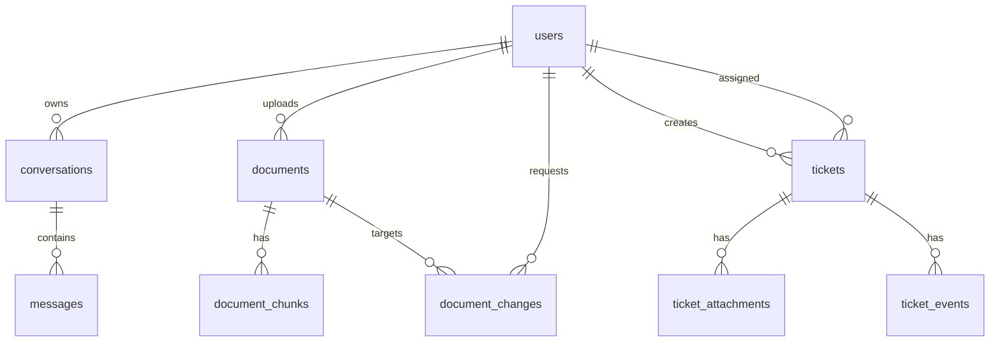

# 03 数据模型与数据库设计

## 1. 设计原则

1. 业务主键统一使用 UUID；大表追加记录（分块、工单事件）使用 `bigserial`。
2. 枚举值在数据库中使用英文编码 + `CHECK` 约束，前端负责中文展示，避免 PostgreSQL 原生 enum 迁移困难。
3. 时间字段统一 `timestamptz`，存 UTC，前端按本地时区显示。
4. 工单使用 `version` 字段做乐观锁，防止并发覆盖。
5. 文档分块与向量同表存储；`pgvector` 维度固定 1024（BGE-M3 dense）。
6. 文档采用软删除：删除时清理分块和 MinIO 对象，保留 `documents` 行和变更历史。

## 2. ER 图



## 3. 枚举定义

### 3.1 角色 `role`

| 编码 | 中文 |
|---|---|
| `employee` | 员工 |
| `leader` | 领导 |

### 3.2 文档变更动作 `document_change_action`

| 编码 | 中文 |
|---|---|
| `create` | 新增 |
| `update` | 修改 |
| `delete` | 删除 |

### 3.3 文档变更状态 `document_change_status`

| 编码 | 中文 |
|---|---|
| `pending` | 待审批 |
| `approved` | 已通过 |
| `rejected` | 已驳回 |

### 3.4 消息角色 `message_role`

| 编码 | 中文 |
|---|---|
| `user` | 用户 |
| `assistant` | 助手 |

### 3.5 工单类型 `ticket_type`

| 编码 | 中文 |
|---|---|
| `it_fault` | IT 故障 |
| `permission_request` | 权限申请 |
| `data_request` | 资料申请 |
| `other` | 其他 |

### 3.6 工单优先级 `ticket_priority`

| 编码 | 中文 |
|---|---|
| `low` | 低 |
| `medium` | 中 |
| `high` | 高 |
| `urgent` | 紧急 |

### 3.7 工单状态 `ticket_status`

| 编码 | 中文 |
|---|---|
| `new` | 新建上传 |
| `pending_assignment` | 待分配 |
| `in_progress` | 处理中 |
| `completed` | 处理完成 |
| `pending_user_confirmation` | 待用户确认 |
| `returned` | 回退员工修改 |
| `modified` | 修改完成 |
| `resolved` | 已解决 |

### 3.8 工单事件动作 `ticket_event_action`

| 编码 | 中文 |
|---|---|
| `created` | 创建工单 |
| `approved` | 审核通过 |
| `rejected` | 审核不通过 |
| `assigned` | 指派处理人 |
| `marked_completed` | 标记处理完成 |
| `confirmed_resolved` | 确认已解决 |
| `confirmed_unresolved` | 确认未解决 |
| `marked_modified` | 标记修改完成 |
| `edited` | 编辑工单 |

## 4. 表结构

### 4.1 `users`

| 列 | 类型 | 约束 | 说明 |
|---|---|---|---|
| `id` | `uuid` | PK, default `gen_random_uuid()` | 用户 ID |
| `username` | `varchar(64)` | UNIQUE, NOT NULL | 登录名 |
| `password_hash` | `varchar(255)` | NOT NULL | bcrypt 哈希 |
| `display_name` | `varchar(64)` | NOT NULL | 显示名 |
| `role` | `varchar(16)` | NOT NULL, CHECK (`employee`,`leader`) | 角色 |
| `is_active` | `boolean` | NOT NULL, default true | 是否启用 |
| `created_at` | `timestamptz` | NOT NULL, default now() | 创建时间 |
| `updated_at` | `timestamptz` | NOT NULL, default now() | 更新时间 |

索引：`UNIQUE(username)`；`INDEX(role)`。

### 4.2 `documents`

只存放当前生效的文档；待审批的新增文档在 `document_changes` 中。

| 列 | 类型 | 约束 | 说明 |
|---|---|---|---|
| `id` | `uuid` | PK | 文档 ID |
| `title` | `varchar(255)` | NOT NULL | 文档标题 |
| `filename` | `varchar(255)` | NOT NULL | 原始文件名 |
| `object_key` | `varchar(512)` | UNIQUE, NOT NULL | MinIO 对象键 |
| `mime_type` | `varchar(128)` | NOT NULL | MIME 类型 |
| `size_bytes` | `bigint` | NOT NULL | 文件大小 |
| `index_status` | `varchar(16)` | NOT NULL, default `pending`, CHECK (`pending`,`indexing`,`ready`,`failed`) | 索引状态 |
| `is_deleted` | `boolean` | NOT NULL, default false | 软删除标记 |
| `uploaded_by` | `uuid` | FK `users(id)`, NOT NULL | 上传人 |
| `created_at` | `timestamptz` | NOT NULL, default now() | 创建时间 |
| `updated_at` | `timestamptz` | NOT NULL, default now() | 更新时间 |

索引：`INDEX(created_at DESC)`。

### 4.3 `document_changes`

| 列 | 类型 | 约束 | 说明 |
|---|---|---|---|
| `id` | `uuid` | PK | 变更 ID |
| `document_id` | `uuid` | FK `documents(id)` ON DELETE SET NULL, NULL | 修改/删除的目标文档；新增为 NULL |
| `action` | `varchar(16)` | NOT NULL, CHECK (`create`,`update`,`delete`) | 变更动作 |
| `status` | `varchar(16)` | NOT NULL, default `pending`, CHECK (`pending`,`approved`,`rejected`) | 审批状态 |
| `title` | `varchar(255)` | NULL | 新增/修改后的标题 |
| `filename` | `varchar(255)` | NULL | 新文件名 |
| `object_key` | `varchar(512)` | NULL | 新文件对象键 |
| `mime_type` | `varchar(128)` | NULL | 新文件 MIME |
| `size_bytes` | `bigint` | NULL | 新文件大小 |
| `requested_by` | `uuid` | FK `users(id)`, NOT NULL | 申请人 |
| `reviewed_by` | `uuid` | FK `users(id)`, NULL | 审批人 |
| `review_comment` | `text` | NULL | 审批意见 |
| `created_at` | `timestamptz` | NOT NULL, default now() | 申请时间 |
| `reviewed_at` | `timestamptz` | NULL | 审批时间 |

业务约束：

```sql
CHECK (
  (action = 'create' AND document_id IS NULL AND title IS NOT NULL AND object_key IS NOT NULL)
  OR (action = 'update' AND document_id IS NOT NULL AND (title IS NOT NULL OR object_key IS NOT NULL))
  OR (action = 'delete' AND document_id IS NOT NULL AND object_key IS NULL)
);

CHECK (
  (status = 'pending' AND reviewed_by IS NULL AND reviewed_at IS NULL)
  OR (status IN ('approved', 'rejected') AND reviewed_by IS NOT NULL AND reviewed_at IS NOT NULL)
);
```

索引：`INDEX(status, created_at DESC)`；`INDEX(requested_by, created_at DESC)`；`INDEX(document_id)`。

### 4.4 `document_chunks`

| 列 | 类型 | 约束 | 说明 |
|---|---|---|---|
| `id` | `bigserial` | PK | 分块 ID |
| `document_id` | `uuid` | FK `documents(id)` ON DELETE CASCADE, NOT NULL | 所属文档 |
| `chunk_index` | `integer` | NOT NULL | 分块序号，从 0 开始 |
| `content` | `text` | NOT NULL | 分块文本 |
| `embedding` | `vector(1024)` | NOT NULL | BGE-M3 稠密向量 |
| `created_at` | `timestamptz` | NOT NULL, default now() | 创建时间 |

约束：`UNIQUE(document_id, chunk_index)`。索引：`INDEX(document_id)`；HNSW 向量索引见第 5 节。

### 4.5 `conversations`

| 列 | 类型 | 约束 | 说明 |
|---|---|---|---|
| `id` | `uuid` | PK | 会话 ID |
| `user_id` | `uuid` | FK `users(id)` ON DELETE CASCADE, NOT NULL | 所属用户 |
| `title` | `varchar(255)` | NOT NULL, default `新对话` | 会话标题 |
| `created_at` | `timestamptz` | NOT NULL, default now() | 创建时间 |
| `updated_at` | `timestamptz` | NOT NULL, default now() | 最后活跃时间 |

索引：`INDEX(user_id, updated_at DESC)`。

### 4.6 `messages`

| 列 | 类型 | 约束 | 说明 |
|---|---|---|---|
| `id` | `uuid` | PK | 消息 ID |
| `conversation_id` | `uuid` | FK `conversations(id)` ON DELETE CASCADE, NOT NULL | 所属会话 |
| `role` | `varchar(16)` | NOT NULL, CHECK (`user`,`assistant`) | 消息角色 |
| `content` | `text` | NOT NULL | 消息内容 |
| `citations` | `jsonb` | NULL | 助手消息的引用列表 |
| `created_at` | `timestamptz` | NOT NULL, default now() | 创建时间 |

索引：`INDEX(conversation_id, created_at)`。

`citations` 结构示例：

```json
[
  {
    "document_id": "UUID",
    "document_title": "员工手册.pdf",
    "chunk_index": 3,
    "snippet": "年假申请需提前 3 个工作日提交……"
  }
]
```

### 4.7 `tickets`

| 列 | 类型 | 约束 | 说明 |
|---|---|---|---|
| `id` | `uuid` | PK | 工单 ID |
| `ticket_no` | `varchar(32)` | UNIQUE, NOT NULL | 人类可读编号 |
| `title` | `varchar(255)` | NOT NULL | 标题 |
| `description` | `text` | NOT NULL | 描述 |
| `type` | `varchar(32)` | NOT NULL, CHECK（四类） | 类型 |
| `priority` | `varchar(16)` | NOT NULL, CHECK（四级） | 优先级 |
| `expected_at` | `timestamptz` | NULL | 期望完成时间 |
| `status` | `varchar(32)` | NOT NULL, CHECK（八态） | 当前状态 |
| `created_by` | `uuid` | FK `users(id)`, NOT NULL | 提交人 |
| `assignee_id` | `uuid` | FK `users(id)`, NULL | 处理人 |
| `resolution` | `text` | NULL | 处理说明 |
| `version` | `integer` | NOT NULL, default 1 | 乐观锁版本 |
| `created_at` | `timestamptz` | NOT NULL, default now() | 创建时间 |
| `updated_at` | `timestamptz` | NOT NULL, default now() | 更新时间 |

索引：`UNIQUE(ticket_no)`；`INDEX(status, created_at DESC)`；`INDEX(created_by, created_at DESC)`；`INDEX(assignee_id, status)`。

工单编号由服务层生成，格式：`T{YYYYMMDD}-{6 位当日序号}`，例如 `T20261109-000001`。序号使用事务型计数表 `ticket_no_counters` 在业务事务内取号，插入失败回滚时序号一起回滚，不再使用 `ticket_no_seq`。

### 4.7.1 `ticket_no_counters`

| 列 | 类型 | 约束 | 说明 |
|---|---|---|---|
| `day` | `date` | PK | UTC 日期 |
| `last_value` | `integer` | NOT NULL, default 0 | 当日已使用的最大序号 |

迁移 `0005_ticket_no_counter` 创建该表，并从已有工单回填每个日期的最大序号。

### 4.8 `ticket_attachments`

| 列 | 类型 | 约束 | 说明 |
|---|---|---|---|
| `id` | `uuid` | PK | 附件 ID |
| `ticket_id` | `uuid` | FK `tickets(id)` ON DELETE CASCADE, NOT NULL | 所属工单 |
| `object_key` | `varchar(512)` | UNIQUE, NOT NULL | MinIO 对象键 |
| `filename` | `varchar(255)` | NOT NULL | 原始文件名 |
| `mime_type` | `varchar(128)` | NOT NULL | MIME |
| `size_bytes` | `bigint` | NOT NULL | 大小 |
| `uploaded_by` | `uuid` | FK `users(id)`, NOT NULL | 上传人 |
| `created_at` | `timestamptz` | NOT NULL, default now() | 上传时间 |

索引：`INDEX(ticket_id)`。

### 4.9 `ticket_events`

| 列 | 类型 | 约束 | 说明 |
|---|---|---|---|
| `id` | `bigserial` | PK | 事件 ID |
| `ticket_id` | `uuid` | FK `tickets(id)` ON DELETE CASCADE, NOT NULL | 所属工单 |
| `actor_id` | `uuid` | FK `users(id)`, NOT NULL | 操作人 |
| `action` | `varchar(32)` | NOT NULL, CHECK（九种） | 动作 |
| `from_status` | `varchar(32)` | NULL | 原状态 |
| `to_status` | `varchar(32)` | NULL | 新状态 |
| `comment` | `text` | NULL | 备注/审批意见 |
| `created_at` | `timestamptz` | NOT NULL, default now() | 发生时间 |

索引：`INDEX(ticket_id, created_at)`。

### 4.10 评测相关表

迁移 `0006_evaluation`。`users` 增加 `can_evaluate boolean default false`。

| 表 | 用途 | 关键列与约束 |
|---|---|---|
| `eval_datasets` | 评测数据集 | `name varchar(100)` 唯一、`is_archived`、`created_by` |
| `eval_cases` | 用例 | `dataset_id` FK CASCADE、`title varchar(255)`、`tags jsonb`、`sort_order` |
| `eval_turns` | 轮次 | `case_id` FK CASCADE、`turn_index`（1–5）、`question`、`reference_answer`、`expected_type`（`answerable`/`unanswerable`）、`required_document_ids jsonb`；`UNIQUE(case_id, turn_index)` |
| `eval_runs` | 运行记录 | `dataset_id`、`retrieval_mode`（`question`/`rewritten`）、`status`（`pending`/`running`/`succeeded`/`failed`/`cancelled`）、`baseline_run_id`、`total_items`、`completed_items`、`metrics jsonb`、`cancel_requested` |
| `eval_run_items` | 逐轮结果快照 | `run_id` FK CASCADE、用例与轮次快照、`status`、检索与引用指标、`judge_score`、`passed`、`answer`、`retrieved jsonb`、`latency_ms`；`UNIQUE(run_id, case_id, turn_index)` |

说明：

- `eval_run_items` 在运行开始时快照用例内容，之后编辑用例不影响历史运行。
- `required_document_ids` 存文档 UUID 字符串数组，不建外键；运行前逐条校验存在、未删除、`index_status=ready`，不满足的轮次标记 `invalid`。
- 评测不写入 `conversations` / `messages`。

## 5. 索引与 pgvector

```sql
CREATE EXTENSION IF NOT EXISTS vector;

CREATE INDEX idx_document_chunks_embedding
ON document_chunks
USING hnsw (embedding vector_cosine_ops)
WITH (m = 16, ef_construction = 64);
```

检索 SQL 形态：

```sql
SELECT id, document_id, chunk_index, content,
       1 - (embedding <=> :query_vector) AS similarity
FROM document_chunks
ORDER BY embedding <=> :query_vector
LIMIT :top_k;
```

- 距离使用余弦距离 `<=>`；相似度 = `1 - 距离`。
- 首版 top-k = 5，不设相似度阈值。
- 可在会话级设置 `SET hnsw.ef_search = 40`，首版使用默认值即可。

## 6. 迁移策略

1. 使用 Alembic 管理所有结构变更。
2. 初始迁移负责：启用 `vector` 扩展、创建全部表、索引和 `ticket_no_seq`；`0005_ticket_no_counter` 新增事务型计数表，此后取号不再使用序列。
3. SQLAlchemy 使用 `pgvector.sqlalchemy.Vector(1024)` 映射向量列。
4. 每次迁移必须在本地库验证 upgrade 和 downgrade（至少 upgrade）。
5. 不在业务代码中执行 DDL。

## 7. 种子数据

| 用户名 | 密码 | 显示名 | 角色 |
|---|---|---|---|
| `leader` | `Leader@123` | 王领导 | `leader` |
| `employee1` | `Employee@123` | 张员工 | `employee` |
| `employee2` | `Employee@123` | 李员工 | `employee` |

说明：

- 密码仅用于本机首版演示，首次登录后应修改；生产部署必须通过环境变量覆盖。
- 种子脚本 `scripts/seed.py` 幂等：用户名已存在则跳过。
- 不预置示例文档；由用户在测试中上传。

## 8. 数据保留与删除

| 对象 | 删除策略 |
|---|---|
| 文档 | 软删除：`is_deleted=true`，删除分块，删除 MinIO 原文件，保留行和变更历史 |
| 文档变更记录 | 保留，作为审批历史；删除文档后 `document_id` 置空 |
| 会话 | 删除 `conversations` 行；`messages` 级联删除 |
| 工单 | 首版不提供删除；记录长期保留 |
| 工单附件 | 随工单级联删除；同时清理 MinIO 对象 |
| 工单事件 | 随工单级联删除；首版不做独立归档 |

> 新增变更通过后，变更记录不关联新文档 ID，以标题和文件名为历史依据。

## 9. 并发控制

1. **工单**：所有状态变更请求携带当前 `version`；SQL 更新条件包含 `id`、`version`、期望状态；影响行数为 0 时返回 409。
2. **文档审批**：通过/驳回只允许 `status='pending'`；并发审批只有一个成功，另一个返回 409。
3. **文档入库**：任务开始前删除该文档旧分块，再批量写入；`UNIQUE(document_id, chunk_index)` 兜底。
4. **文档索引状态**：上传或审批通过后置 `pending`；任务开始置 `indexing`；成功后置 `ready`；失败置 `failed`，领导可重新索引。
5. **重复上传**：不做内容去重；同一文件可多次上传，产生不同文档记录。

## 10. 数据量与容量估算

- 1 万文档，平均 20 个分块 → 20 万分块。
- 每个 1024 维 float32 向量约 4KB → 向量总量约 800MB。
- 加上文本、索引和业务数据，预计 2–4GB；本机 545GB 空闲空间充足。
- HNSW 索引常驻内存约 1GB 量级，32GB 内存可承受。
- 100 工单/天 → 每年约 3.65 万条，业务表压力很小。

## 11. 中文展示映射

前端统一使用以下映射，不在数据库存中文：

| 字段 | 编码 → 中文 |
|---|---|
| `role` | `employee` → 员工；`leader` → 领导 |
| `document_change_action` | `create` → 新增；`update` → 修改；`delete` → 删除 |
| `document_change_status` | `pending` → 待审批；`approved` → 已通过；`rejected` → 已驳回 |
| `document_index_status` | `pending` → 待索引；`indexing` → 索引中；`ready` → 可检索；`failed` → 索引失败 |
| `ticket_type` | `it_fault` → IT 故障；`permission_request` → 权限申请；`data_request` → 资料申请；`other` → 其他 |
| `ticket_priority` | `low` → 低；`medium` → 中；`high` → 高；`urgent` → 紧急 |
| `ticket_status` | `new` → 新建上传；`pending_assignment` → 待分配；`in_progress` → 处理中；`completed` → 处理完成；`pending_user_confirmation` → 待用户确认；`returned` → 回退员工修改；`modified` → 修改完成；`resolved` → 已解决 |
