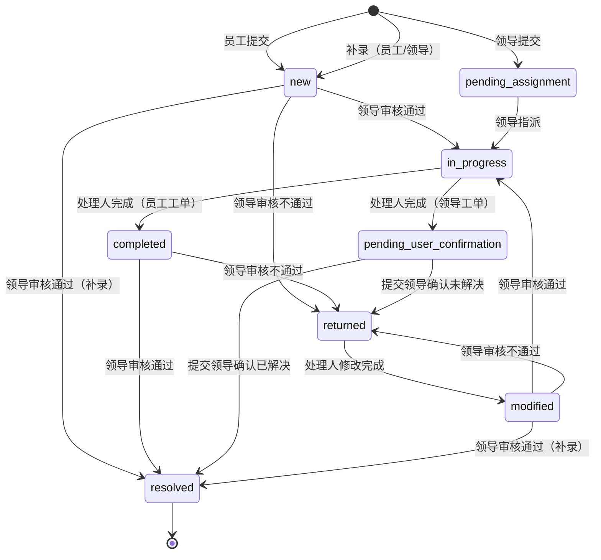

# 05 工单状态机与权限矩阵

## 1. 状态定义

| 状态 | 中文 | 出现场景 |
|---|---|---|
| `new` | 新建上传 | 员工提交后等待领导初审；补录工单提交后同样进入此状态，等待领导审核 |
| `pending_assignment` | 待分配 | 领导提交后，等待领导指派处理人 |
| `in_progress` | 处理中 | 已指派处理人，处理人正在处理 |
| `completed` | 处理完成 | 员工工单的处理人已标记完成，等待领导终审 |
| `pending_user_confirmation` | 待用户确认 | 领导工单的处理人已标记完成，等待提交领导确认 |
| `returned` | 回退员工修改 | 领导驳回，或提交领导确认未解决，等待处理人修改 |
| `modified` | 修改完成 | 处理人已修改并标记，等待领导审核 |
| `resolved` | 已解决 | 终态 |

## 2. 状态转换表

| 当前状态 | 动作 | 执行人 | 结果状态 | 条件/说明 |
|---|---|---|---|---|
| — | 创建工单 | 员工 | `new` | 员工提交 |
| — | 创建工单 | 领导 | `pending_assignment` | 领导提交，直接待分配 |
| — | 补录工单 | 员工 | `new` | 只能补录自己的工单；可填原创建时间和过去的期望完成时间 |
| — | 补录工单 | 领导 | `new` | 可指定任意启用中的员工作为提交人 |
| `new` | `approve` | 领导 | `in_progress` | 非补录工单；`assignee_id` 可省略，默认提交人；必须是启用中的员工 |
| `new` | `reject` | 领导 | `returned` | `comment` 必填 |
| `new` | `approve` | 领导 | `resolved` | 补录工单审核通过，直接已解决，不设处理人 |
| `pending_assignment` | `assign` | 领导 | `in_progress` | `assignee_id` 必填 |
| `in_progress` | `complete` | 当前处理人 | `completed` | 员工提交的工单 |
| `in_progress` | `complete` | 当前处理人 | `pending_user_confirmation` | 领导提交的工单 |
| `completed` | `approve` | 领导 | `resolved` | 员工工单终审通过 |
| `completed` | `reject` | 领导 | `returned` | `comment` 必填 |
| `pending_user_confirmation` | `confirm(resolved=true)` | 提交领导 | `resolved` | 领导工单确认已解决 |
| `pending_user_confirmation` | `confirm(resolved=false)` | 提交领导 | `returned` | `comment` 必填 |
| `returned` | `edit` | 当前处理人 | `returned` | 只更新内容，状态不变；`version` 递增 |
| `returned` | `modify_complete` | 当前处理人 | `modified` | 可附备注 |
| `modified` | `approve` | 领导 | `in_progress` | 非补录工单；修改审核通过，回到处理中；若当前无处理人，`assignee_id` 省略时默认提交人 |
| `modified` | `reject` | 领导 | `returned` | `comment` 必填 |
| `modified` | `approve` | 领导 | `resolved` | 补录工单修改完成审核通过，直接已解决 |
| `resolved` | — | — | — | 终态，不允许再操作 |

### 2.1 处理人的定义

- 已指派：`assignee_id` 指向的用户。
- 未指派：`created_by` 指向的提交人。

`new` 被驳回后进入 `returned`，此时尚未指派，由提交人修改。`completed` 或 `pending_user_confirmation` 被驳回后进入 `returned`，由当前处理人修改。

## 3. 完整流程

### 3.1 员工提交

```text
新建上传（new）
  ├─ 领导审核通过（可指定处理人，默认提交人）→ 处理中（in_progress）
  └─ 领导审核不通过 → 回退员工修改（returned）
        └─ 处理人修改 → 修改完成（modified）
              └─ 领导审核通过 → 处理中（in_progress）
                    └─ 领导审核不通过 → 回退员工修改（returned）

处理中（in_progress）
  └─ 处理人标记完成 → 处理完成（completed）
        ├─ 领导审核通过 → 已解决（resolved）
        └─ 领导审核不通过 → 回退员工修改（returned）
              └─ 修改完成 → 领导审核通过 → 处理中 → …
```

### 3.2 领导提交

```text
新建上传（pending_assignment）
  └─ 领导指派处理人 → 处理中（in_progress）
        └─ 处理人标记完成 → 待用户确认（pending_user_confirmation）
              ├─ 提交领导确认已解决 → 已解决（resolved）
              └─ 提交领导确认未解决 → 回退员工修改（returned）
                    └─ 处理人修改 → 修改完成（modified）
                          ├─ 领导审核通过 → 处理中（in_progress）→ …
                          └─ 领导审核不通过 → 回退员工修改（returned）
```

### 3.3 补录历史工单

```text
补录（new）
  ├─ 领导审核通过 → 已解决（resolved）
  └─ 领导审核不通过 → 回退员工修改（returned）
        └─ 提交人修改 → 修改完成（modified）
              ├─ 领导审核通过 → 已解决（resolved）
              └─ 领导审核不通过 → 回退员工修改（returned）
```

补录工单不经过 `pending_assignment` / `in_progress` / `completed` / `pending_user_confirmation`，不设处理人；驳回后的修改人固定为提交人（`created_by`）。

## 4. 状态图



说明：`returned` 状态下允许处理人多次 `edit`，状态不变，只递增 `version`。

## 5. 权限矩阵

### 5.1 角色与数据范围

| 角色 | 可查看的工单 |
|---|---|
| 员工 | 自己提交的 + 指派给自己的 |
| 领导 | 全部 |

### 5.2 动作权限

| 动作 | 员工（提交人） | 员工（处理人） | 领导（非提交人） | 领导（提交人） |
|---|---|---|---|---|
| 创建工单 | 可以 | 可以 | 可以 | 可以 |
| 补录工单 | 只能补录自己 | 只能补录自己 | 可指定任意员工为提交人 | 可以 |
| 查看工单详情 | 自己的 | 指派给自己的 | 全部 | 全部 |
| `approve` 初次审核 | — | — | 可以 | 可以 |
| `reject` 初次审核 | — | — | 可以 | 可以 |
| `assign` 指派 | — | — | 可以 | 可以 |
| `complete` 标记完成 | 仅当自己是处理人 | 可以 | 仅当自己是处理人 | 仅当自己是处理人 |
| `modify_complete` | 仅当自己是处理人 | 可以 | 仅当自己是处理人 | 仅当自己是处理人 |
| `approve` 终审（员工工单） | — | — | 可以 | 可以 |
| `reject` 终审（员工工单） | — | — | 可以 | 可以 |
| `confirm`（领导工单） | — | — | — | 可以 |
| `edit`（`returned`） | 仅当自己是处理人 | 可以 | 仅当自己是处理人 | 仅当自己是处理人 |
| 新增/删除附件（`returned`） | 仅当自己是处理人 | 可以 | 仅当自己是处理人 | 仅当自己是处理人 |
| 查看/下载附件 | 可查看工单即可 | 可查看工单即可 | 可查看工单即可 | 可查看工单即可 |

说明：

- "员工（提交人）"和"员工（处理人）"可能是同一个人；两个身份的动作取并集。
- 领导如果不是该工单的提交人，也能审核员工工单；首版只有一个领导角色，因此所有工单都由同一个领导审核。
- 领导提交的工单，`pending_user_confirmation` 只能由提交该工单的领导确认；首版只有一个领导，实际等价于领导确认。

### 5.3 available_actions 计算

| 状态 | 当前用户 | 可用动作 |
|---|---|---|
| `new` | 领导 | `approve`, `reject` |
| `pending_assignment` | 领导 | `assign` |
| `in_progress` | 当前处理人 | `complete` |
| `completed` | 领导 | `approve`, `reject` |
| `pending_user_confirmation` | 提交领导 | `confirm_resolved`, `confirm_unresolved` |
| `returned` | 当前处理人 | `edit`, `modify_complete`, `add_attachment`, `delete_attachment` |
| `modified` | 领导 | `approve`, `reject` |
| `resolved` | 任何人 | 无 |

其他用户不返回任何动作；后端仍会拒绝未授权请求。

补录工单（`is_backfilled=true`）的动作不同：`new` / `modified` 状态下领导只有 `approve`、`reject`；`returned` 状态下只有提交人（`created_by`）有 `edit`、`modify_complete`、`add_attachment`、`delete_attachment`；没有 `assign`、`complete`、`confirm`。

映射关系：`confirm_resolved` / `confirm_unresolved` 都调用 `POST /tickets/{id}/confirm`，`resolved` 分别为 `true` / `false`；`add_attachment` / `delete_attachment` 分别调用附件上传和删除接口。

## 6. 非法转换

以下情况返回 `409 TICKET_INVALID_TRANSITION`：

- 对 `resolved` 状态执行任何动作。
- 对 `in_progress` 执行 `approve` / `reject` / `assign`。
- 对 `new` 执行 `complete` / `modify_complete` / `confirm` / `assign`。
- 对 `pending_assignment` 执行 `complete` / `approve` / `confirm`。
- 对 `completed` 执行 `complete` / `confirm` / `assign`。
- 对 `pending_user_confirmation` 执行 `approve` / `reject` / `complete`。
- 对 `returned` 执行 `approve` / `reject` / `complete` / `confirm`。
- 对 `modified` 执行 `complete` / `modify_complete` / `confirm` / `assign`。

越权（角色或数据范围不满足）返回 `403 TICKET_FORBIDDEN_ACTION`；资源不存在或无权查看返回 `404 NOT_FOUND`。

## 7. 并发控制

1. 所有状态变更接口必须携带 `version`。
2. 服务端执行条件更新：

```sql
UPDATE tickets
SET status = :to_status,
    assignee_id = :assignee_id,
    resolution = :resolution,
    version = version + 1,
    updated_at = now()
WHERE id = :ticket_id
  AND version = :version
  AND status = :expected_from_status;
```

3. 影响行数为 0 时：
   - 重新读取工单：版本不同 → `409 CONFLICT_VERSION`。
   - 版本相同但状态不同 → `409 TICKET_INVALID_TRANSITION`。
4. 每次成功变更写入一条 `ticket_events`，与工单更新在同一事务中提交。

## 8. 事件记录

| 动作 | `ticket_events.action` | `from_status` → `to_status` |
|---|---|---|
| 创建工单 | `created` | `null` → `new` / `pending_assignment` |
| 审核通过 | `approved` | 当前状态 → 新状态 |
| 审核不通过 | `rejected` | 当前状态 → `returned` |
| 指派 | `assigned` | `pending_assignment` → `in_progress` |
| 标记处理完成 | `marked_completed` | `in_progress` → `completed` / `pending_user_confirmation` |
| 确认已解决 | `confirmed_resolved` | `pending_user_confirmation` → `resolved` |
| 确认未解决 | `confirmed_unresolved` | `pending_user_confirmation` → `returned` |
| 标记修改完成 | `marked_modified` | `returned` → `modified` |
| 编辑工单 | `edited` | `returned` → `returned` |

事件中的 `actor_id` 记录实际操作人，`comment` 记录审批意见或处理说明。工单详情页按时间正序展示时间线。

## 9. 边界规则

1. **状态与提交人绑定**：`new` 只用于员工提交的工单；`pending_assignment` 只用于领导提交的工单。
2. **终审绑定**：`completed` 只用于员工提交的工单；`pending_user_confirmation` 只用于领导提交的工单。
3. **修改回路**：任何进入 `returned` 的工单，都必须经过 `modified` 和领导审核，才能回到 `in_progress`。
4. **处理人不可为空**：只要工单进入 `in_progress`，`assignee_id` 必须非空。
5. **已解决工单只读**：`resolved` 后不允许编辑、补充附件或重新打开；首版不提供重开。
6. **工单不进入知识库**：工单解决后只保留记录，不写入文档或向量表。
7. **管理动作留痕**：所有状态变化都写 `ticket_events`，首版用于时间线展示，不扩展为独立审计系统。
